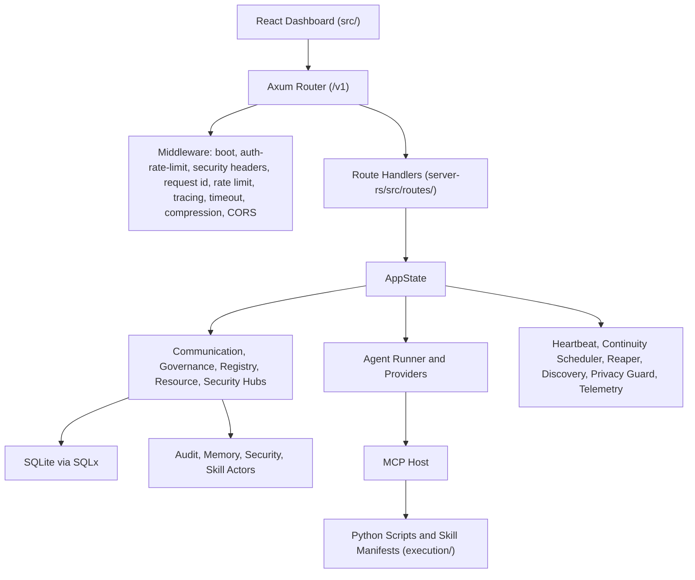

> [!IMPORTANT]
> **AI Assist Note (Knowledge Heritage)**:
> This document is part of the "Sovereign Reality" documentation.
> - **@docs ARCHITECTURE:Documentation**
> - **Failure Path**: Information drift, legacy terminology, or documentation mismatch.
> - **Telemetry Link**: Search `[ARCHITECTURE]` in audit logs.
>
> ### AI Assist Note
> Core technical resource for the Tadpole OS Sovereign infrastructure.
>
> ### 🔍 Debugging & Observability
> Traceability via `parity_guard.py`.

# Tadpole OS Architecture

Tadpole OS is a local-first, zero-trust sovereign agent operations platform with a React dashboard, a Rust Axum engine, SQLite persistence, and an isolated execution layer for skills and MCP tools. Features Aletheia independent verification gates, zero-trust container/Wasm sandboxing, and dynamic DAG task orchestration.

## High-Level Runtime

Agent lifecycle transitions use 64 bounded async lock stripes across gateway, scheduled execution, recruitment, and terminal persistence. Acquire lifecycle locks before SQLite transactions; inference runs outside those locks. Creation uses an explicit insert path and updates require an existing row with the expected version. Batch saves publish versions after commit and preserve conflicts for the caller. Mission termination atomically commits agent state, mission status/log, and task usage in `server-rs/src/agent/runner/terminal.rs`, checks the active mission identity, and rejects stale or duplicate completion.

The engine initializes supervised audit, memory, security, and skill actors during startup and stops their supervisor during shutdown. Memory saves persist text in SQLite in either feature build; queries return bounded literal text matches and identify `sqlite-text` as their backend. Vector indexing supplements that durable text. Event automation and provider-backed cognitive consolidation have explicit startup flags, disabled by default. Event listeners continue after broadcast lag and track at most 16 concurrent job executors, retaining the current event's remaining mappings until slots become available. Already admitted executors finish cleanup if the monitor stops; saturation can still drop broadcast events. Consolidation bounds source batches, releases registry references before inference, meters reported usage, and compares source records transactionally before replacing them.

## Layers

| Layer | Paths | Responsibilities |
| --- | --- | --- |
| Interface | `src/`, `src/services/telemetry_buffer.ts` | Dashboard pages, layout, stores, hooks, API clients, IndexedDB rolling telemetry cache (7-day TTL), and detached windows. |
| Engine | `server-rs/src/` | HTTP/WebSocket API, AppState, agent runner, providers, middleware, security, telemetry, actors, and background workers. |
| Cognition & Compactor | `server-rs/src/agent/runner/turn_compactor.rs`, `server-rs/src/agent/runner/parser.rs`, `server-rs/src/agent/runner/execution_metrics.rs`, `server-rs/src/agent/runner/refinement.rs` | Pinned-tail context compaction (last 3 turns uncompressed), disk spill to `.tmp/tool_overflow/`, balanced-brace tool syntax recovery, atomic telemetry rollup, and structured error diagnostics. |
| Token & Context | `server-rs/src/agent/tokenizer.rs`, `server-rs/src/agent/context_manager.rs`, `server-rs/src/agent/context_slicer.rs` | Model-aware BPE token counting (< 1µs DashMap LRU cache), 2-Tier context compression, and adaptive 3-zone context slicing with strict `tiktoken` budget enforcement. |
| OTP Supervision | `server-rs/src/system/actors/supervisor.rs`, `server-rs/src/system/actors/manager.rs` | Erlang/OTP-style supervision tree with `OneForOne`/`OneForAll` strategies, `AbortHandle` deterministic shutdown, stability-based exponential backoff, and `DashMap` child registry. |
| Concurrency & Guards | `server-rs/src/security/conflict.rs`, `server-rs/src/security/dependency_guard.rs` | `ConflictManager` with 30s TTL file write leases, and `DependencyGuard` thread-safe cached system binary discovery. |
| Hybrid RAG Fusion | `server-rs/src/services/rag_fusion.rs` | Reciprocal Rank Fusion (RRF) combining LanceDB Vector, BM25 Lexical, and TrustGraph Entity search with multi-engine intersection boosting. |
| Durable Workflows | `server-rs/src/agent/durable.rs`, `server-rs/migrations/20260822000100_durable_workflows.sql` | SQLite-native step memoization with SHA-256 parameter hashing, crash fast-forwarding, and mutation-aware re-execution. |
| Socratic Contracts | `server-rs/src/agent/socratic.rs` | 0-Turn Socratic contract envelope auto-injection (Scope, Performance Threshold, Architecture Mode, Pre-Cleared Failure Policies) with typed `BlastRadiusLevel` and zero-allocation `Cow<str>`. |
| Swarm Pulse Telemetry | `server-rs/src/telemetry/pulse.rs`, `server-rs/src/telemetry/sink.rs`, `crates/wasm-codec/` | Real-time MessagePack pulse stream with dynamic reasoning turn progress, 7-day auto-rotating JSONL file sink, and MIT clean-room WASM Postcard pulse codec. |
| Swarm Orchestration | `server-rs/src/agent/dag.rs`, `server-rs/src/agent/blackboard.rs`, `server-rs/src/agent/cascade_router.rs`, `server-rs/src/agent/verification_gate.rs`, `server-rs/src/agent/runner/swarm_persistence.rs` | Dynamic DAG task parallelism, shared mission blackboard, tiered model cascading, topological directive cycle rejection, and zero-trust Aletheia verification gate. |
| Code Intelligence | `server-rs/src/intelligence/`, `src/components/intelligence/` | Directed AST symbol graph, token-budgeted symbol context injection (`get_symbol_context`), blast-radius calculation, and impacted test targeting (`/v1/intelligence/impacted-tests`). |
| Tool & Skill Dispatch | `server-rs/src/agent/runner/tools/mod.rs`, `server-rs/src/agent/script_skills/mod.rs`, `server-rs/src/agent/hooks.rs` | Zero-Trust pipeline (Budget Check -> Token Validation -> WAL -> CBS -> Oversight -> Sandboxed Subprocess Execution), atomic snapshot capability registry (`DashMap`), deterministic disk script trapping, and environment-isolated 10s timed hook runner. |
| Subsystems | `server-rs/src/agent/trustgraph.rs`, `server-rs/src/services/bm25_memory.rs`, `server-rs/src/routes/a2a.rs`, `starter_kits/` | TrustGraph GraphRAG entity traversal, BM25 Lexical search engine (< 1ms), A2A 2PC budget ledger, and multi-agent domain starter kits. |
| Execution | `execution/`, `execution/lib/` | Python tools, JSON skill manifests, MCP host, native IPC bridge client (`execution/lib/mcp_client.py`), `tool_loop_guard.py` circuit breaker, and verification utilities. |
| Persistence | `data/`, `server-rs/src/db/`, `server-rs/migrations/` | Modular SQLite database subsystem with contract tests, migrations (`20260304000100`–`20260918000100`), runtime registries, cache files, and gated schema reconciliation (`ALLOW_MIGRATION_RECONCILE=true`). |
| Directives and docs | `directives/`, `docs/` | Governance documents, operating directives, API reference, OpenAPI, and operations documentation. |

## Engine Boot Sequence

The engine starts in `server-rs/src/main.rs`.

1. Installs a panic hook that writes `sidecar_panic.log`.
2. Applies `WORKSPACE_ROOT` by changing the process working directory when configured.
3. Builds a custom Tokio runtime.
4. Handles fast-path CLI options such as `--version`, `--help`, and `--status`.
5. Loads `.env` and validates environment schema behavior through `startup::load_environment`.
6. Initializes tracing and OpenTelemetry unless disabled.
7. Creates `AppState`, including the database pool, registries, hubs, security services, MCP host, and skill registry.
8. Starts background tasks from `startup::spawn_background_tasks`.
9. Spawns system actors under OTP supervisor tree and attaches the actor registry.
10. Launches the orchestrator loop.
11. Builds the Axum router and binds to `BIND_ADDRESS:PORT`, defaulting to `127.0.0.1:8000`.
12. Signals boot completion, serves requests, and flushes state during graceful shutdown.

## AppState Hubs

`server-rs/src/state/mod.rs` decomposes runtime state into hubs:

| Hub | Purpose |
| --- | --- |
| CommunicationHub | Broadcast logs, events, telemetry, audio streams, pulse data, oversight queues, and active runners. |
| GovernanceHub | Runtime limits, privacy mode, budgets, active agent counters, recruitment counts, and depth constraints. |
| RegistryHub | Agents, providers, models, nodes, skills, MCP host, hooks, and tool registry. |
| ResourceHub | SQLite pool, HTTP client, audio cache, code graph, parser, hardware profiler, ACL, renderer, and semaphores. |
| SecurityHub | Audit trail, budget guard, shell scanner, secret redactor, security monitor, permission policy, and deploy token. |

## Routing And Middleware

`server-rs/src/router.rs` nests routes under `/v1` and applies:

- boot readiness middleware
- auth brute-force limiter
- security headers
- request ID injection
- atomic rate limiting (`parking_lot::Mutex` inside `moka::sync::Cache`) with `Retry-After` and `X-RateLimit-*` headers
- tracing spans
- deprecation middleware
- 256 KiB request payload size limit (accommodating `MAX_TASK_LENGTH`)
- 120-second timeout (aligned with client-side 110-second request budgets)
- compression
- CORS with 600s preflight caching and exposed diagnostic headers

Public routes:

- `GET /v1/engine/health`

Protected route groups require `Authorization: Bearer <NEURAL_TOKEN>` (or `Sec-WebSocket-Protocol: bearer.<NEURAL_TOKEN>` for `/v1/engine/ws` and `/v1/engine/live-voice`):

- agents, oversight, infrastructure, model manager, skills, benchmarks, continuity, docs, system, governance, sovereign session state, memory search (including `/v1/memory/search/hybrid` for Triad RRF), engine control, and MCP bridge routes.

When `STATIC_DIR` exists, defaulting to `dist`, the router serves the dashboard build and falls back to `index.html` for client-side routing.

## Background Workers

`server-rs/src/startup/mod.rs` starts runtime workers:

- CodeGraph warmup for source indexing in full boot mode.
- Heartbeat event loop that emits `engine:health`.
- Continuity scheduled job executor.
- Swarm reaper with retention behavior.
- Optional vector-memory cleanup behind the `vector-memory` feature.
- SME connector ingestion worker.
- mDNS swarm discovery in full boot mode.
- Privacy guard.
- Rate-limit bucket eviction.
- Telemetry metric aggregation.
- Debounced budget usage flush.
- High-speed swarm pulse loop in full boot mode.
- Declarative swarm recipe ingestion.

## Frontend Architecture

`src/App.tsx` initializes the dashboard runtime:

- provider defaults and backend provider sync
- visual monitor bridge
- VRAM monitor service
- autonomous Browser Sentinel daemon boot when sentinel mode is enabled (`src/services/sentinel_daemon.ts`)
- agent registry hydration
- background route pre-loading
- theme and density attributes
- route-to-tab synchronization

Routes are registered in `src/constants/routes.ts` and rendered through `Dashboard_Layout`.

### Browser Sentinel & Local Cognitive Shield

The Browser Sentinel operates as a client-side, zero-cloud sentry for real-time DOM health, UI entropy monitoring, and security isolation:

1. **Quantized In-Browser Inference (`src/services/browser_inference.ts`)**:
   - Executes `HuggingFaceTB/SmolLM-360M-Instruct` (or `onnx-community/SmolLM2-360M-Instruct-ONNX`) in strict 4-bit quantization (`dtype: 'q4'`), requiring only ~220MB model storage and ~350MB peak VRAM.
   - Hardware-accelerated device fallback chain: WebGPU $\to$ WASM $\to$ CPU.
   - Dynamic KV-cache & token trimming adjusted in real time based on VRAM pressure (32–128 tokens).
   - Explicit lifecycle buffer disposal via `dispose()` to prevent WebGPU memory leaks and handle browser `device.lost` events.

2. **Autonomous Sentinel Daemon (`src/services/sentinel_daemon.ts`)**:
   - Executes background evaluation on a 25-second idle cadence using `requestIdleCallback` (with timeout fallback).
   - Triple Circuit Breakers:
     - *Tab Visibility*: Skips execution when `document.hidden === true` to conserve GPU/CPU resources on background tabs.
     - *VRAM Resource Guard*: Defers scans when memory pressure enters `critical` ($\ge 95\%$).
     - *Pipeline Concurrency*: Defers scans when user inference or model initialization is already in flight.

3. **Deterministic Secret & Credential Pre-Flight Shield (DLP) (`src/utils/security_utils.ts`)**:
   - Zero-latency regex DLP interceptor run at prompt intake in `command_processor.ts` and DOM summarization in `browser_specialist_store.ts`.
   - Redacts OpenAI (`sk-proj-...`), Anthropic (`sk-ant-...`), Google (`AIzaSy...`), GitHub tokens (`ghp_...`, `gho_...`), Bearer tokens, and RSA/EC private keys before any model reasoning, logging, or cloud dispatch occurs.

4. **Reactive Specialist State & Governance UI Integration (`src/stores/browser_specialist_store.ts`, `src/pages/Governance_View.tsx`)**:
   - Real-time reactive Zustand store synchronized via listener subscriptions.
   - Governance screen provides live status ribbons (`Dormant`, `Warming Up %`, `Auditing DOM...`, `Sentinel Active · WEBGPU`), hardware execution core indicators, escalated anomaly tracking, manual "Run Audit Now" trigger, and one-click "Reset Pipeline" recovery.

## Persistence

- Default database: `sqlite:<workspace>/data/tadpole.db`.
- Override with `DATABASE_URL`.
- Migrations live in `server-rs/migrations/` (includes `20260822000100_durable_workflows.sql`, `20260912000100_audit_hot_indexes.sql`, `20260912000200_a2a_ledger_expiry.sql`, and `20260918000100_iacp_events_fallback.sql`).
- Providers and models are persisted during graceful shutdown.
- Agent records are loaded from SQLite and saved through batched database writes.
- Audio cache defaults to `data/audio_cache.db`.
- Mission creation, activation, and versioned agent assignment commit in one transaction; registry publication follows commit. The runner establishes mission cleanup ownership before context preparation and keeps that ownership if terminal persistence fails.
- Read-before-write agent/initialization transactions use `BEGIN IMMEDIATE` to avoid SQLite upgrade deadlocks while retaining strict expected-version checks. Agent snapshots release DashMap shard locks before database awaits.
- Initialization and terminal persistence own their commit/publication boundaries across caller cancellation. Server-owned mission receipts retain acknowledged provider usage and scheduled-run identity through partial turns, workflows, preemption, and temporary cleanup-write failure. Replacement initialization settles the stopped mission before assigning the next one. Receipts are removed after terminal commit or committed agent deletion; receipts and pending quota buffers remain volatile across process termination.
- Agent persistence separates provider/model catalog storage and lifecycle recovery into sibling modules. The shared agent update helper lives in the persistence layer; quota settlement lives in `server-rs/src/security/metering/settlement.rs`.
- Quota settlement retains pending agent and mission charges until their shared transaction commits. An owned settlement task survives cancellation of its caller, preserves concurrent additions, and excludes admission reads during commit and buffer settlement. Pending buffers remain volatile across process termination.
- Stale recovery holds the agent lifecycle lock, preserves live tracked executions, and uses the same versioned terminal persistence as the runner. Scheduler and orchestrator recovery share this policy.
- Stale recovery owns commit/publication through caller cancellation and isolates per-agent write failures. Other candidates still recover; the sweep returns its first error after processing them.

## Feature Gates

Default Cargo features are empty.

| Feature | Effect |
| --- | --- |
| `vector-memory` | Enables LanceDB/Arrow-backed memory routes and cleanup. Without it, memory endpoints return `501 Not Implemented`. |
| `neural-audio` | Enables optional audio/native dependencies. |

## Code Intelligence & Blast Radius Engine

Tadpole OS integrates a high-fidelity **Code Intelligence & Blast Radius Engine** (`server-rs/src/intelligence/`):

- **In-Memory Dependency Graph**: Builds a directed symbol graph of all functions, structs, classes, and interfaces across the Rust and TypeScript codebase.
- Rust call references include module-qualified, associated, and generic function/method calls, with byte-accurate source spans. Static name resolution remains heuristic and does not prove dynamic dispatch or alias resolution.
- **Visual Force-Directed Layout**: The frontend renders this dependency graph dynamically under the **Neural Map** page using `react-force-graph-2d` for interactive exploration.
- **Blast Radius Analysis**: Traces incoming edges to calculate the downstream impact of editing any specific code symbol, returning all files and functions that depend on it.
- **Selective Test Targeting**: Exposes `GET /v1/intelligence/impacted-tests` and agent tool `get_impacted_tests` to determine which test suites are impacted by code changes, accelerating agent verification loops.
- **Token-Budgeted AST Symbol Context**: Exposes agent tool `get_symbol_context`, resolving exact syntax-tree definitions into agent prompt windows constrained by a strict token budget.
- **Autonomous Agent Integration**: Exposed as native agent tools (`get_blast_radius`, `get_symbol_context`, `get_impacted_tests`), enabling the agent swarm to inspect dependencies and run targeted test validation prior to committing edits.
- **Lock Decoupling & Token Caching**: File discovery and parsing are performed outside the RwLock read/write guards, preventing concurrency starvation. Symbol token counts are pre-calculated and cached on node compilation to yield zero-overhead BFS context resolution.

## Sovereign Engine Hardening

The engine implements several strategies to ensure resilience and zero-panic operation:

- **OTP Actor Supervision Tree** (`server-rs/src/system/actors/supervisor.rs`): Erlang/OTP-style supervision engine supporting `OneForOne` (restart individual) and `OneForAll` (cascade restart) strategies with `AbortHandle` deterministic hard shutdown, exponential backoff with stability-based reset, and lockless `DashMap` child registry.
- **Durable Workflow Step Memoization** (`server-rs/src/agent/durable.rs`): SQLite-native crash-resilient execution engine. Completed agent workflow steps are SHA-256 hashed and cached; on engine restart, previously completed steps are fast-forwarded from SQLite with zero token waste.
- **Aletheia Verification Gate** (`server-rs/src/agent/verification_gate.rs`): Zero-trust dual-agent verification for high-impact mutations. Enforces independent Verifier blast-radius calculation to mitigate the "Honesty Problem" of generator self-reporting.
- **Self-Annealing Intelligence**: The `PolyglotParser` provides structured feedback on malformed tool calls, allowing the `IntelligenceLoop` to automatically re-prompt models for correction.
- **Panic Remediation**: Critical paths in the bridge, parser, and security modules use safe error propagation (via `Result` and `AppError`) rather than non-recoverable panics.
- **Non-Blocking Orchestration**: All filesystem I/O in the MCP execution and Memory Palace rehydration modules is migrated to `tokio::fs` to prevent event-loop stalling.
- **Lock-free Read Queries**: Read-based code graph queries execute concurrently while workspace scans compile on background blocking threads, preventing request timeouts.
- **Memory Sweep Isolation**: Per-agent consolidation errors are logged and retained as a sweep error after other agents are processed; denial, empty provider output, and persistence conflicts preserve source memories.
- **Frontend History Integrity**: History, branch discovery, reversion, and promotion use the shared HTTP service with the configured in-memory credential and backend URL. History replacement publishes messages and their ID index together.

## Swarm Orchestration Engine

The Next-Gen Swarm Orchestration layer provides production-grade subsystems:

| Subsystem | Module | Purpose |
| --- | --- | --- |
| Dynamic DAG Task Engine | `server-rs/src/agent/dag.rs` | Directed task dependency graph with `petgraph::StableDiGraph`, topological cycle rejection, parallel ready-queue extraction, state transition validation, and deadlock-free failure cascading via BFS `Skipped` propagation. |
| Directive Delegation Guard | `server-rs/src/agent/runner/swarm_persistence.rs` | Enforces topological BFS acyclicity checks during directive persistence (`save_directive`), rejecting circular agent delegation graphs at the API boundary to prevent deadlocks. |
| Shared Mission Blackboard | `server-rs/src/agent/blackboard.rs` | High-performance thread-safe in-memory scratchpad (`DashMap` + `Arc<BlackboardEntry>`) for multi-agent data exchange, replacing large prompt string passing with lightweight key pointers. |
| Tiered Model Cascade Router | `server-rs/src/agent/cascade_router.rs` | Dynamic turn routing between Tier 1 Fast (Ollama/Groq/Gemini Flash) and Tier 2 Frontier Reasoning (Gemini Pro/Claude/GPT-4o) with configurable critical keywords and capability-aware error escalation. |
| Aletheia Verification Gate | `server-rs/src/agent/verification_gate.rs` | Zero-trust Generator→Verifier triad for high-impact mutations with `HashSet` O(1) sensitive skill gating and independent Verifier blast-radius evaluation. |
| Adaptive Context Slicer | `server-rs/src/agent/context_slicer.rs` | Cognitive 3-zone prompt assembly (Pinned Anchors, `<grounded_context>` RAG, Sliding Active Window) with strict `tiktoken` BPE token budget enforcement and pre-allocated heap buffers. |
| Live Swarm HUD & Dispatch | `src/components/Swarm_Visualizer.tsx` | Real-time active mission topology synthesis with dangling edge removal and Quick Command Bar for direct operator directive dispatch. |

## Hybrid RAG Triad Fusion

The retrieval layer fuses three complementary search engines using **Reciprocal Rank Fusion (RRF)** (`server-rs/src/services/rag_fusion.rs`):

$$RRF\_Score(d) = \sum_{e \in \{\text{Vector}, \text{BM25}, \text{Graph}\}} \frac{w_e}{k + rank_e(d)}$$

| Engine | Weight | Module |
| --- | --- | --- |
| LanceDB Vector | 0.40 | `server-rs/src/agent/memory.rs` |
| BM25 Lexical | 0.35 | `server-rs/src/services/bm25_memory.rs` |
| TrustGraph Entity | 0.25 | `server-rs/src/agent/trustgraph.rs` |

Exposed via `GET /v1/memory/search/hybrid` for unified multi-engine retrieval with deduplication and intersection boosting.

## Model Registry, Context Windows & Pricing Governance

Tadpole OS integrates complete end-to-end telemetry and governance for model context sizing and token cost calculation:

- **Model Registry Architecture (`server-rs/src/routes/model_manager.rs`, `server-rs/src/agent/types.rs`, `src/stores/model_store.ts`)**:
  - `ModelEntry` and `ModelConfig` declare `context_window` (u32/number), `input_cost_per_m` (f64/number), and `output_cost_per_m` (f64/number) alongside rate bounds (`rpm`, `tpm`, `rpd`, `tpd`).
  - Strict serialization parity bridge ensures seamless interoperability across TypeScript frontend and Rust backend via Serde aliases (`context_window` / `contextWindow`, `input_cost_per_m` / `inputCostPerM`, `output_cost_per_m` / `outputCostPerM`).
- **End-to-End Task Payload Wiring**:
  - Both domain contracts (`Task_Payload` in `src/contracts/agent/domain.ts`) and Rust engine types (`TaskPayload` in `server-rs/src/agent/types.rs`) support contextual overrides.
  - The agent execution pipeline merges payload limits into active runner `ModelConfig` via `merge_payload_overrides` and automatically propagates limits down swarm hierarchies via `derive_subtask_payload`.
- **Dynamic Cost Calculation (`server-rs/src/agent/rates.rs`)**:
  - Custom rates override default tier assumptions through `calculate_cost_with_custom_rates(input_tokens, output_tokens, custom_in_m, custom_out_m)`.
  - The runtime tracks real-time expenditure in reasoning loops (`server-rs/src/agent/runner/intelligence.rs`) and records cumulative cost into the A2A ledger upon mission finalization (`server-rs/src/agent/runner/finalize.rs`).

## Structured Reasoning, Prompt Caching & Deterministic Verification

The agent execution pipeline in `server-rs/src/agent/runner/` enforces rigorous message structure, context accounting, and output validation:

1. **Native Multi-Role `ChatMessage` Protocol (`server-rs/src/agent/types.rs`)**:
   - Replaces unstructured string flattening with typed `ChatMessage` variants: `System`, `User`, `Assistant`, and `Tool`.
   - Tool execution results are returned strictly as `ChatMessage::Tool`, isolating observation outputs from instruction streams and eliminating indirect prompt injection vectors.
   - Converts legacy turns via `ChatMessage::from_legacy_turn()`.

2. **Native Ephemeral Prompt Caching (`server-rs/src/agent/anthropic.rs`, `server-rs/src/agent/gemini.rs`)**:
   - Automatically serializes Anthropic system blocks with `cache_control: {"type": "ephemeral"}`.
   - Provider caches the large, immutable system instructions on edge nodes, cutting per-turn input token costs by up to 90% and reducing latency on multi-turn reasoning loops.

3. **Context Window Token Accounting (`server-rs/src/agent/runner/turn_compactor.rs`, `server-rs/src/agent/runner/provider.rs`)**:
   - `estimate_messages_token_count` computes model-aware token usage using `TokenizerService` before making network requests.
   - When cumulative tokens exceed the model's `context_window` capacity (or `CapabilityMatrix::infer_capabilities`), execution halts with `AppError::ContextOverflow`.
   - Classified as `ErrorClass::Repairable` and `ErrorScope::Turn`, enabling the compaction engine to offload observations to `.tmp/tool_overflow/` and recover without terminating the mission.

4. **Tool Repetition & Recursion Guard (`server-rs/src/agent/runner/intelligence.rs`)**:
   - A thread-safe tracker monitors consecutive identical `(tool_name, args_hash)` calls.
   - **At 3 identical calls**: Injects a `[TOOL_WARNING]` advising the agent to change strategy.
   - **At 5 identical calls**: Aborts execution with `RunnerError::RecursionBlocked`, preventing runaway token expenditure.
   - Pre-turn budget gate enforces a `$10.00` limit fallback (`DEFAULT_BUDGET_LIMIT_USD`).

5. **Deterministic Artifact Verification (`server-rs/src/agent/runner/mission_tools.rs`)**:
   - Tool `complete_mission` supports an optional `artifacts` array in its manifest schema.
   - Verifies that all declared artifact files physically exist on disk within `workspace_root`.
   - If any declared file is missing, rejects completion with `ToolExecutionError::Validation`, forcing the agent to produce the artifact before closing the mission.

6. **20-Task Ground Truth Evaluation Suite (`evals/tasks.json`, `evals/run.py`)**:
   - Fully automated ground-truth benchmark suite asserting 20 core architectural capabilities (schema validation, loop guards, budget gates, prompt caching, hierarchy intercepts, Merkle continuity, and recovery fallbacks).
   - Executable via `npm run test:evals` or `python evals/run.py`.

7. **Execution Resilience, Shared Tool Cache & Security Watchdogs (`server-rs/src/agent/runner/`)**:
   - **Shared Tool Cache (`server-rs/src/agent/runner/tools/cache.rs`)**: Replaces indiscriminate SQLite caching with a strict in-memory LRU tool cache. Only read-only tools are cached; cached entries validate monotonic `mtime` and file byte size, and invalidation occurs instantly on mutating tools (`write_file`, `patch_file`, `replace_file_content`, `run_command`).
   - **Cyclic DoomLoopDetector (`server-rs/src/agent/runner/loop_detector.rs`)**: Evaluates JSON-normalized SHA-256 signatures of tool call invocations and outputs to detect multi-turn cyclic loops (periods 1, 2, 3, and 4), aborting infinite oscillations before consuming mission budget.
   - **Two-Stage Monologue Compaction (`server-rs/src/agent/runner/monologue.rs`)**: Strips embedded execution logs (>2,000 chars) and dense LLM summarization for turns outside the hot tail (last 4 turns) with deterministic fallback summarization.
   - **SSRFGuard (`server-rs/src/security/ssrf_guard.rs`)**: Comprehensive outbound HTTP security validating schemes, ports, and IP ranges (rejecting RFC 1918, RFC 5737, loopback, CGNAT, link-local, IPv6 ULA) and directly pinning resolved IPs in `reqwest::ClientBuilder` to defeat DNS rebinding.
   - **SpanWatchdog (`server-rs/src/telemetry/span_watchdog.rs`)**: Background sweep service enforcing provider-specific TTLs (60s cloud, 300s Ollama) on open telemetry spans, auto-closing orphans with `SPAN_TIMEOUT_REAPED` events.
   - **Mission Benchmark Harness (`tests/mission_bench/`)**: Standardized 5-scenario benchmark test suite (`tests/mission_bench/run.py` and `tests/mission_bench/judge.py`) asserting system invariants.

[//]: # (Metadata: [ARCHITECTURE])

